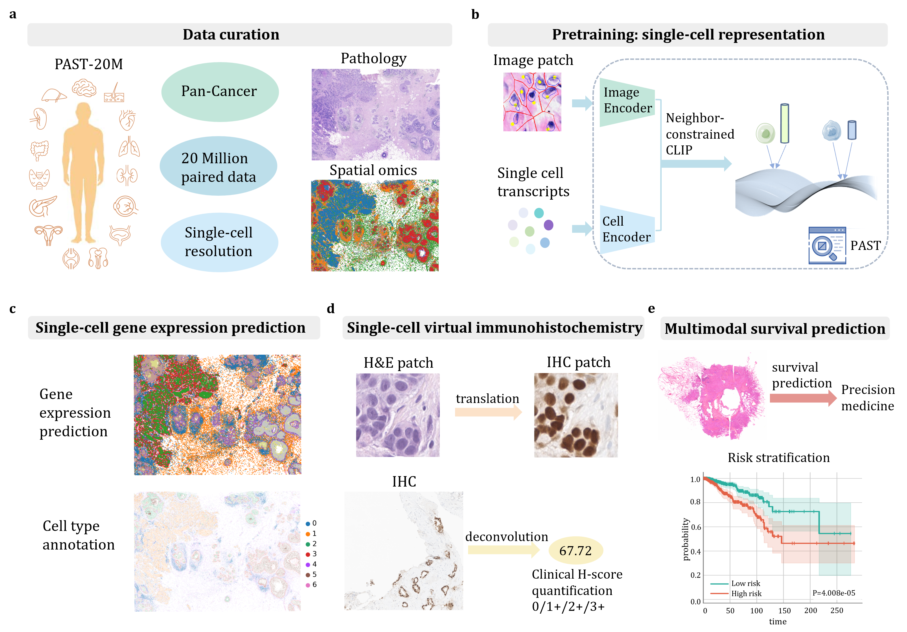

# Single-cell resolution with pan-cancer generalization in morpho-molecular foundation modeling from histopathology with PAST

[](LICENSE)
[](https://arxiv.org/pdf/2507.06418)
[](https://huggingface.co/Boyoungc/CHROMA_pretrain/tree/main)

---



**PAST** (Pathology And Single-cell Transcriptomics) is a foundation model that jointly integrates histopathology images and single-cell transcriptomes at unprecedented scale and resolution. Unlike traditional pathology foundation models that rely solely on morphological features, PAST learns unified cross-modal representations capturing both spatial and molecular heterogeneity at the cellular level.


---

## 📝 Key Features

- Single-cell Resolution: First model to integrate 20 million paired histopathology images and single-cell transcriptomes
- Pan-cancer Coverage: Trained across 15 distinct tumor types with robust cross-cancer generalization
- Single-cell gene expression prediction from H&E slides
- Virtual immunohistochemistry with quantitative H-Score readouts
- Enhanced multimodal survival prediction

---

## 🎉 News

- 2025/10: Initial code and weights released!

---

## 🔧 Installation

### Create Environment

```bash
# Clone the repository
git clone https://github.com/your-username/PAST.git
cd PAST

# Create conda environment
conda create -n past python=3.11
conda activate past

# Install dependencies
pip install -r requirements.txt
```

---

## 🚀 Pre-trained Models

Model	Weights Link	Description

[PAST-pretrain](https://huggingface.co/Boyoungc/PAST/tree/main)

---

## 🧑‍💻 Quick Start

```python
import torch
import os

# Download checkpoint from Hugging Face
# https://huggingface.co/Boyoungc/PAST/tree/main

# Loading Pretrained Encoders, We provide separately saved pretrained weights for the image encoder and cell encoder, which can be loaded independently.

import torch
from models import PASTModelGraph

# Initialize PAST
model = PASTModelGraph()

# Load pretrained encoder weights
image_weights = torch.load(
    "past_image_encoder_context300.pth",
    map_location="cpu",
    weights_only=True
)

cell_weights = torch.load(
    "past_cell_encoder_context300.pth",
    map_location="cpu",
    weights_only=True
)

# Load Image Encoder
model.image_encoder.model.load_state_dict(
    image_weights, strict=True
)

# Load Cell Encoder
model.cell_encoder.load_state_dict(
    cell_weights, strict=True
)

model.eval()

# Note on the Omics Encoder: Although we provide the pretrained cell encoder and an interface for processing omics data,
# PAST was not specifically pretrained to learn general-purpose omics representations.
# Therefore, the cell # encoder is provided primarily for completeness and flexibility, and its effectiveness as a standalone omics feature extractor has not been systematically evaluated.
# We recommend validating its performance before using it for # downstream omics-specific tasks.

```

## Extract Image Features from H&E Patches

```python
from PIL import Image
import torchvision.transforms as transforms

# Load and preprocess image
transform = transforms.Compose([
    transforms.Resize(224),
    transforms.CenterCrop(224),
    transforms.ToTensor(),
    transforms.Normalize(mean=[0.485, 0.456, 0.406], 
                       std=[0.229, 0.224, 0.225])
])

image = Image.open("cell_patch.png")
image_tensor = transform(image).unsqueeze(0)

# Extract features
with torch.no_grad():
    image_features = model.image_encoder(image_tensor)
    
print(f"Image feature shape: {image_features.shape}")
```

## Single-Cell Gene Expression Prediction

PAST can also be fine-tuned to predict single-cell gene expression directly from H&E image patches. We provide training and evaluation scripts for two settings in the [`resources/`](resources/) directory:

- **Same-Tissue:** Train on slides from the same tissue type while holding out a target slide for evaluation.
- **Leave-One-Out (LOO):** Train on other tissue types and evaluate on an unseen tissue type.

The required resources, including per-slide gene indices (`data_idx`) and example pretrained prediction models for breast tissue under both settings, are available on [Zenodo (10.5281/zenodo.23448720)](https://doi.org/10.5281/zenodo.23448720).

#### Preparing Gene Indices

The `data_idx` directory contains a `.npy` file for each Xenium slide, storing the sorted union of gene indices observed across its cells. These files can be downloaded from Zenodo or generated from the corresponding tokenized H5 files:

```python
import h5py
import numpy as np
from pathlib import Path

data_dir = Path("path/to/tokenized/pretrain/Xenium")
output_dir = Path("./data_idx")
output_dir.mkdir(parents=True, exist_ok=True)

for h5_file in sorted(data_dir.glob("*.h5")):
    gene_indices = set()

    with h5py.File(h5_file, "r") as f:
        for indices in f["X_model_indices"]:
            gene_indices.update(indices)

    np.save(
        output_dir / f"{h5_file.stem}.npy",
        np.array(sorted(gene_indices), dtype=np.int64)
    )
```

The example generates indices for all H5 files. The original preprocessing script excluded samples identified as Xenium 5K.

#### Training and Evaluation

**Same-Tissue**

The following example trains on breast tissue slides while holding out one slide for evaluation.

```bash
python resources/exp_past_same_tissue_train_original_aligned.py \
    --target_tissue breast \
    --target_sample human_breast_FFPEHBUTESA_Replicate_1 \
    --feature_mode union \
    --output_dir ./results/same_tissue
```

Evaluate the trained model:

```bash
python resources/exp_past_same_tissue_eval_original_aligned.py \
    --model_dirs ./results/same_tissue/same_tissue_breast_human_breast_FFPEHBUTESA_Replicate_1_union \
    --output_dir ./results/same_tissue_eval
```

**Leave-One-Out**

The following example excludes all breast tissue slides from training and evaluates the model on a held-out breast slide.

```bash
python resources/exp_past_leave_one_out_train.py \
    --target_tissue breast \
    --feature_mode union \
    --output_dir ./results/leave_one_out
```

Evaluate the trained model:

```bash
python resources/exp_past_leave_one_out_eval.py \
    --model_dirs ./results/leave_one_out/leave_one_out_breast_union \
    --test_sample human_breast_FFPEHBUTESA_Replicate_1 \
    --output_dir ./results/leave_one_out_eval
```

Both settings fine-tune a ViT-Large image encoder for gene expression regression and report gene-level and cell-level Pearson correlations, MSE, and other evaluation metrics.

#### Using Pretrained Prediction Models

We also provide example **breast tissue gene expression prediction checkpoints** for both Same-Tissue and Leave-One-Out settings on [Zenodo](https://doi.org/10.5281/zenodo.23448720).

To perform inference without retraining, download the corresponding model checkpoint (`best_model.pt`) and its training configuration (`train_config.json`), organize them in a model directory, and run the appropriate evaluation script above with `--model_dirs` pointing to that directory.

The evaluation scripts automatically reconstruct the prediction model using the gene indices stored in the checkpoint and generate expression predictions for the specified test slide.

**Note:** Update the dataset paths and pretrained PAST checkpoint path in the scripts to match your local environment. The `data_idx` directory is expected under the working directory unless the code is adjusted accordingly. Use the provided gene mapping and expression preprocessing conventions when preparing your own datasets.


## 🏋️‍♂️ Pretraining PAST from Scratch

To pretrain PAST, use the following command (example for 8 GPUs):

```python
torchrun --nproc_per_node=8 --master_port=48798 \
    PAST_train.py \
    --exp_name 'past_pretraining' \
    --batch_size 48 \
    --num_workers 16 \
    --save_interval 10000 \
    --accum_iter 5 \
    --distributed True \
    --output_dir ./output_dir_context300 \
    --log_dir ./output_dir_context300

```

Change --nproc_per_node based on the number of GPUs you have.


---

## 📄 Citation

If you use PAST, please cite:

```python
@article{yang2025past,
  title={Past: A multimodal single-cell foundation model for histopathology and spatial transcriptomics in cancer},
  author={Yang, Changchun and Li, Haoyang and Wu, Yushuai and Zhang, Yilan and Jiao, Yifeng and Zhang, Yu and Huang, Rihan and Cheng, Yuan and Qi, Yuan and Guo, Xin and others},
  journal={arXiv preprint arXiv:2507.06418},
  year={2025}
}
```

---

## 📮 Contact

For questions or collaborations, please contact:

changchun.yang@kaust.edu.sa
